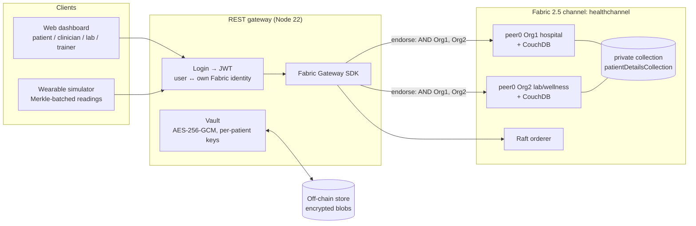

# Blockchain Healthcare — patient-controlled health data sharing

A permissioned-blockchain system in which **patients decide who can see their health data**: clinicians, labs, personal trainers and their own wearable devices. Every grant, revoke, record change and record view is recorded on a shared ledger that no single party can quietly rewrite.

This repository is a reworked copy of [alexmj8/BlockchainHealthcare](https://github.com/alexmj8/BlockchainHealthcare) (Alejandro Mateo Jiménez, Apache-2.0). It contains:

| Folder | What it is | Stack |
|---|---|---|
| [`healthcare-network/`](healthcare-network/) | **The original application, repaired.** Its core bugs and access-rule leaks are fixed, it has real tests, and it runs end to end on a local Fabric 1.2 network with one command per step. | Hyperledger Composer 0.20, Fabric 1.2, Node 8 (in Docker) |
| [`healthcare-fabric/`](healthcare-fabric/) | **The recommended redesign.** The application ported to Fabric 2.5 with the improvements proposed in the review: encrypted off-chain records, consent with expiry, emergency access, access log, lab uploads, private data with erasure, batched wearable data, per-user identities, a REST gateway and a web dashboard. | Fabric 2.5.16, Fabric CA 1.5.22, Node 20/22, CouchDB |

The untouched upstream clone lives next to this folder in `../BlockchainHealthcare-original/` for comparison.

📄 **[CHANGES.md](CHANGES.md)** explains, issue by issue, what was wrong, what was changed (with before/after code and file references), and how each fix was verified.

---

## Contents

1. [What changed and why](#1-what-changed-and-why)
2. [Quick start — Fabric 2.5 version (recommended)](#2-quick-start--fabric-25-version-recommended)
3. [Quick start — original Composer version (fixed)](#3-quick-start--original-composer-version-fixed)
4. [Architecture of the Fabric 2.5 version](#4-architecture-of-the-fabric-25-version)
5. [Chaincode reference](#5-chaincode-reference)
6. [REST API reference](#6-rest-api-reference)
7. [Security model](#7-security-model)
8. [Tests](#8-tests)
9. [Troubleshooting](#9-troubleshooting)
10. [Limitations and next steps](#10-limitations-and-next-steps)

---

## 1. What changed and why

Each row is an issue found in the review of the original project, and how it is fixed.

### Broken logic

| Issue in the original | Fixed in Composer version | Fixed in Fabric 2.5 version |
|---|---|---|
| Grant/revoke started from `var list = []` (`lib/logic.js:30`, `:83`, revoke functions). Granting Doctor B removed Doctor A, and revoking one lab removed every lab. | `addUnique` / `removeById` start from the **current** list and change only one entry ([`lib/logic.js`](healthcare-network/lib/logic.js)) | Each consent is **its own ledger key** `(patient, provider)`, so one grant or revoke cannot touch another |
| Record IDs from `Math.random()`, so peers could compute different results and the transaction would fail endorsement | ID = transaction ID | ID = `ctx.stub.getTxID()`; all times come from the tx timestamp |
| Trainer access stored only on the trainer side | `Patient.authorizedTrainers` added and kept in sync | Same consent model for every provider type |
| `UpdateMedicalRecord` set `lastConsultationWith` to the *previous* author | Set to the clinician doing the update | Author/version tracked per update, with full history |
| Tests were the Composer template (`SampleAsset`…) | 23 real tests against the embedded runtime | 38 chaincode unit tests, 10 gateway tests, 14 end-to-end checks |

### Security: access rules leaked data

| Issue in the original | Fix |
|---|---|
| Clinicians and labs could edit their own `patients` list (`CliniciansOnlySeeThemselves` had `ALL`), so a doctor could add any patient and then read their record | Providers have **read-only** access to their own participant record; only a patient-signed consent transaction can change it |
| Patients could update **any** clinician/lab/trainer (`PatientsUpdateClinicians`: `READ, UPDATE`, no condition) | Allowed only inside the matching Grant/Revoke transaction, and only for the provider named in it (`transaction(tx)` + condition) |
| A wearable could post data for **any** patient and update/delete any reading | A wearable is paired with one patient; it may only *create* readings for that patient. Fabric 2.5: patient comes from the pairing, not from the request |
| Health records in plaintext on every peer's ledger, forever | Fabric 2.5: AES-256-GCM encrypted **off-chain**; the ledger stores only SHA-256 + pointer. Personal details in a **private data collection** that can be **purged** |
| Identity cards (private keys + enrollment secrets) and an API token committed | Removed; `.gitignore` for cards and wallets; [gitleaks](.gitleaks.toml) in CI and a pre-commit hook |
| Any participant could read every historian record (the full transaction history) | `OnlyOwnHistory` denies reading other participants' history |

### Missing features and old technology

| Gap | Fabric 2.5 version |
|---|---|
| No patient app or doctor dashboard; only Composer Playground | Web dashboard (patient / clinician / lab / trainer views) and a REST API with login |
| Labs could read but not upload results | `addLabResult` with the `lab:write` scope |
| Access never expired | Every consent has scopes and a mandatory expiry (max. 1 year) |
| No emergency access | Break-glass `emergencyAccess` — 24 h, read-only, reason required, visible to the patient |
| No log of who viewed a record | Reading content goes through `accessRecord`, which writes an audit entry; the patient sees who, when, why, and under which grant |
| No support for files (scans, PDFs) | Records are arbitrary encrypted documents stored off-chain; only the hash is on-chain |
| Composer deprecated (2019), Fabric 1.2 | Fabric 2.5 LTS, `fabric-contract-api`, Fabric Gateway SDK, chaincode lifecycle |
| One organisation, one peer | Two organisations (Org1 = hospital, Org2 = lab/wellness), endorsement policy `AND(Org1, Org2)` |
| One transaction per reading every 3 s | Readings are batched; one transaction holds the Merkle root and summary of a window |

---

## 2. Quick start — Fabric 2.5 version (recommended)

### Prerequisites

* Linux or macOS with **Docker** (Docker Desktop: give it **≥ 6 GB RAM**) and `git`, `curl`, `openssl`
* **Node.js 22.12+** for the gateway (`@hyperledger/fabric-gateway` requires it; `nvm use` reads `gateway/.nvmrc`). The chaincode itself runs in Fabric's own Node container.
* Python 3.8+ with `requests` for the wearable simulator
* Free ports: 7050, 7051, 7053, 7054, 8054, 9051, 9054, 5984, 7984, 3000

### Run it

```bash
cd healthcare-fabric

# 1. Network: downloads Fabric 2.5.16 binaries + images on first run (~1.5 GB),
#    starts 2 orgs + orderer + CAs + CouchDB, creates 'healthchannel',
#    deploys the chaincode with the private-data collection.
./network/network.sh up

# 2. Users: registers the demo users with their CA, putting hc.role / hc.id
#    into each certificate, and prints a login password for each.
./network/network.sh enroll

# 3. Gateway + dashboard
cd gateway
npm install
npm start                      # http://localhost:3000
```

Open **http://localhost:3000** and sign in with a password printed by `enroll` (also stored in `gateway/wallet/credentials.txt`, which is git-ignored).

| User | Role | Organisation | Try this |
|---|---|---|---|
| `alice`, `bob` | patient | Org1 | grant/revoke access, read the access log, save/erase personal details, pair a wearable |
| `drA`, `drB` | clinician | Org1 | write/update records for patients who granted access, use emergency access |
| `labA` | lab | Org2 | upload lab results |
| `trainer` | personal trainer | Org2 | view wearable summaries, verify a Merkle proof |
| `band` | wearable | Org1 | used by the simulator |

On first login each user is registered on the ledger automatically, from their certificate.

### Verify everything (in another terminal)

```bash
cd healthcare-fabric/gateway
npm run e2e                    # 14 end-to-end checks against the live network

# smart band: a reading every 3 s, one blockchain transaction per 20 readings
# (alice must have paired 'band-alice' first; e2e does this, or use the dashboard)
python3 ../simulator/wearable_simulator.py --batch-size 20 --interval 3
```

### Stop

```bash
./network/network.sh down      # removes containers, ledger, crypto material, wallet and off-chain data
```

Upgrading the chaincode after a code change: `CC_VERSION=1.1 CC_SEQUENCE=2 ./network/network.sh deploy` (bump both each time).

### Configuration (gateway environment variables)

| Variable | Default | Purpose |
|---|---|---|
| `PORT` | `3000` | HTTP port |
| `HC_MASTER_KEY` | *generated into `data/master.key`* | base64 32-byte key-encryption key. **Set it (from a KMS/secret store) outside development** |
| `HC_JWT_SECRET` | *random per start* | session signing secret |
| `HC_JWT_TTL` | `1h` | session lifetime |
| `HC_CHANNEL` / `HC_CHAINCODE` | `healthchannel` / `healthcare` | |
| `HC_ORG1_PEER` / `HC_ORG2_PEER` | `localhost:7051` / `localhost:9051` | peer endpoints |
| `HC_TEST_NETWORK`, `HC_WALLET`, `HC_DATA` | under `network/.fabric`, `gateway/wallet`, `gateway/data` | paths |

---

## 3. Quick start — original Composer version (fixed)

Hyperledger Composer was deprecated in 2019 and only runs on Node 8. Everything below runs inside pinned Docker images, so **nothing old is installed on your machine**.

```bash
cd healthcare-network

# Unit tests (lint + 23 tests on Composer's embedded runtime)
docker run --rm -u $(id -u):$(id -g) -e HOME=/tmp -v "$PWD":/app -w /app node:8 \
  sh -c "npm ci && npm test"

# Full stack on a local Fabric 1.2 network
./scripts/network.sh up          # orderer, peer, CA, CouchDB + channel 'composerchannel'
./scripts/network.sh deploy      # build dist/healthcare-network@0.8.0.bna, install, start, import admin card
./scripts/network.sh seed        # demo patient, clinician, lab, trainer, wearable + their identity cards
./scripts/network.sh rest band 3001        # REST API as the wearable  -> http://localhost:3001/explorer
./scripts/network.sh rest admin 3000       # REST API as admin         -> http://localhost:3000/explorer
./scripts/network.sh playground            # Composer Playground       -> http://localhost:8080
./scripts/network.sh cli card list         # any composer CLI command

# Simulator (Python 3) for the patient and band IDs printed by 'seed'
python3 wearable_simulator.py --url http://localhost:3001 \
  --patient bc855cdad45161ecb5123dcb4c3d9118 --device fa7d182a88ea8d6faa876ce5373d03b1

./scripts/network.sh down        # remove containers, chaincode images and the local card store
```

The first `scripts/network.sh` call builds `healthcare/composer-tools:0.20.9` (Node 8 + `composer-cli`, `composer-rest-server`, `composer-playground`) from [`docker/composer-tools.Dockerfile`](healthcare-network/docker/composer-tools.Dockerfile). Cards are stored in `healthcare-network/.composer-home/` (git-ignored).

**What it took to make the original run** (all in `healthcare-network/`):

* `package.json`: every dependency was `"latest"`, which no longer installs on Node 8. Versions are now pinned (Composer 0.20.9, mocha 5, eslint 5…); the stale `.bna` was removed.
* Fabric 1.2's default chaincode builder is `fabric-ccenv:latest`. On a machine with newer Fabric images this is a Go-only 2.x/3.x image, so `composer network start` failed with `npm: not found`. The builder is now pinned to `fabric-ccenv:1.2.1` in the dev-server `docker-compose.yml`.
* `composer-rest-server` crashed on start (`File is not defined`) because an unpinned transitive dependency (`swagger-client`) now needs Node 18+. The tools image pins a Node-8-compatible release.
* The simulator was Python 2 (`print(...).format` crashes on Python 3) with a hard-coded token and IDs. It is rewritten for Python 3 with CLI arguments and environment variables.
* All `.card` files (private keys + enrollment secrets) were deleted; `seed` issues fresh identities locally.

---

## 4. Architecture of the Fabric 2.5 version



**Writing a record:** clinician → gateway encrypts the content with the patient's data key → stores the blob off-chain → submits `createRecord(patientId, title, sha256(blob), uri)` signed with the **clinician's own key** → both orgs check consent and endorse → ordered → committed.

**Reading a record:** user → gateway submits `accessRecord(recordId, purpose)`. The chaincode checks consent or emergency access and writes an access-log entry. The gateway then loads the blob, **verifies its SHA-256 against the ledger** (tamper detection) and decrypts it.

**Wearables:** the band buffers readings and sends a window of them with their Merkle root. The gateway recomputes the root, stores the raw readings encrypted, and submits **one** `submitWearableBatch` with root + stats. `GET …/proof/:i` returns a Merkle proof that reading *i* is part of the on-chain batch.

### Layout

```
healthcare-fabric/
├── chaincode/                 fabric-contract-api smart contract
│   ├── lib/healthcareContract.js
│   ├── lib/roles.js           roles, scopes, least-privilege table
│   └── test/                  38 unit tests with an in-memory stub
├── network/
│   ├── network.sh             up | deploy | enroll | down  (wraps fabric-samples test-network)
│   ├── collections_config.json
│   ├── users.conf             demo users: org, hc.role, hc.id
│   └── .fabric/               downloaded Fabric binaries + samples (git-ignored)
├── gateway/
│   ├── src/app.js             REST routes
│   ├── src/fabric.js          per-user Fabric Gateway connections
│   ├── src/auth.js            scrypt passwords + JWT
│   ├── src/vault.js           envelope encryption, integrity check, crypto-shredding
│   ├── src/merkle.js          Merkle root / proof / verify
│   ├── public/                dashboard (vanilla JS, CSP-friendly)
│   ├── scripts/e2e.js         end-to-end checks
│   └── test/                  10 unit tests
└── simulator/wearable_simulator.py
```

---

## 5. Chaincode reference

Contract name `healthcare`. The caller is always taken from the certificate (`MSP` + `hc.role` + `hc.id`), never from the arguments.

| Function | Who | Purpose |
|---|---|---|
| `registerParticipant(displayName)` | patient, clinician, lab, trainer | register yourself (role and ID come from the certificate; bound to your MSP) |
| `getMyProfile()` / `listProviders(role?)` | any | own profile / public provider directory |
| `registerWearable(deviceId, name)` / `unpairWearable(deviceId)` | patient | pair or unpair a device |
| `grantAccess(providerId, scopesJson, expiresAt)` | patient | create or replace **one** provider's consent |
| `revokeAccess(providerId)` | patient | revoke one provider (including emergency access) |
| `listMyConsents()` | patient, provider | consents given / received |
| `emergencyAccess(patientId, reason)` | clinician | 24 h break-glass read access, logged |
| `createRecord(patientId, title, sha256, uri)` | clinician + `records:write` | new medical record pointer |
| `updateRecord(recordId, sha256, uri)` | clinician + `records:write` | new version |
| `addLabResult(patientId, testName, sha256, uri)` | lab + `lab:write` | lab result pointer |
| `accessRecord(recordId, purpose)` | patient or `records:read` | **submit** before decrypting; writes the access log |
| `listRecords(patientId)` / `getRecordHistory(recordId)` | patient or `records:read` | metadata / version history |
| `getAccessLog()` | patient | who viewed what, when, why, and under which grant |
| `setMyDetails()` *(transient `details`)* / `getPatientDetails(id)` / `eraseMyDetails()` | patient / `details:read` / patient | personal details in the private collection; erase = `purgePrivateData` |
| `submitWearableBatch(batchJson)` | paired wearable | Merkle root + stats for a window of readings |
| `listWearableBatches(patientId)` | patient or `wearable:read` | wearable summaries |

**Scopes allowed per provider role** (least privilege, enforced in the chaincode):

| Role | Can be granted |
|---|---|
| clinician | `records:read`, `records:write`, `details:read`, `wearable:read` |
| lab | `records:read`, `lab:write`, `details:read` |
| trainer | `wearable:read`, `details:read` |

---

## 6. REST API reference

All endpoints except login need `Authorization: Bearer <token>`. Each call is signed with the logged-in user's own Fabric identity.

| Method & path | Role | Chaincode |
|---|---|---|
| `POST /api/login` `{username, password}` | — | (registers the participant on first login) |
| `GET /api/me` · `GET /api/providers?role=` | any | `getMyProfile` · `listProviders` |
| `GET /api/consents` | patient, provider | `listMyConsents` |
| `POST /api/consents` `{providerId, scopes[], expiresAt}` | patient | `grantAccess` |
| `DELETE /api/consents/:providerId` | patient | `revokeAccess` |
| `POST /api/emergency` `{patientId, reason}` | clinician | `emergencyAccess` |
| `GET /api/access-log` | patient | `getAccessLog` |
| `GET /api/patients/:id/records` | patient, authorised | `listRecords` |
| `POST /api/patients/:id/records` `{title, content}` | clinician | encrypt → `createRecord` |
| `POST /api/patients/:id/lab-results` `{testName, content}` | lab | encrypt → `addLabResult` |
| `GET /api/records/:recordId?purpose=` | patient, authorised | `accessRecord` → verify hash → decrypt |
| `PUT /api/records/:recordId` `{content}` | clinician | encrypt → `updateRecord` |
| `GET /api/records/:recordId/history` | patient, authorised | `getRecordHistory` |
| `PUT /api/me/details` · `GET /api/patients/:id/details` · `DELETE /api/me/details` | patient · authorised · patient | private data; delete also crypto-shreds off-chain data |
| `POST /api/wearables` `{deviceId, name}` · `DELETE /api/wearables/:deviceId` | patient | pair / unpair |
| `POST /api/wearables/batch` `{readings[], merkleRoot}` | wearable | verify root → store → `submitWearableBatch` |
| `GET /api/patients/:id/wearables` | patient, authorised | `listWearableBatches` |
| `GET /api/patients/:id/wearables/:batchId/proof/:index` | patient, authorised | Merkle proof for one reading |

Example:

```bash
TOKEN=$(curl -s localhost:3000/api/login -H 'content-type: application/json' \
  -d '{"username":"alice","password":"<from credentials.txt>"}' | jq -r .token)
curl -s localhost:3000/api/consents -H "authorization: Bearer $TOKEN" -H 'content-type: application/json' \
  -d '{"providerId":"clinician-a","scopes":["records:read","records:write"],"expiresAt":"2026-12-31T23:59:59Z"}'
```

---

## 7. Security model

* **Identity.** Each organisation's Fabric CA issues certificates with `hc.role` and `hc.id` attributes. On registration the chaincode binds that ID to the issuing MSP. Another organisation's CA cannot mint a certificate that impersonates it, because MSP, role and ID must all match.
* **Login.** App passwords are stored as scrypt hashes, with constant-time comparison and a rate-limited login endpoint. Sessions are short-lived JWTs. Every request is executed with *that user's* key, so the gateway never acts as a super-user on the ledger.
* **Consent.** Scoped, time-limited and per provider. Expiry is checked against the transaction timestamp, so the result is deterministic across peers. The endorsement policy `AND(Org1MSP.peer, Org2MSP.peer)` means neither organisation can change data alone.
* **Confidentiality.** No health data on the ledger: records are AES-256-GCM encrypted with a per-patient data key, wrapped by a master key. The ledger keeps SHA-256 hash + URI, and any modified blob is rejected. Personal details live in a private data collection (`memberOnlyRead/Write`), so only their hash enters blocks.
* **Erasure.** `eraseMyDetails` uses Fabric 2.5 `purgePrivateData` (removed from state *and* private history on all peers). The gateway also deletes the patient's data key ("crypto-shredding"), making every off-chain copy unreadable.
* **Audit.** Consent changes emit events. Every content read and every emergency access is a ledger entry that the patient can list.
* **Secrets.** No keys, cards or tokens in the repository. `wallet/`, `data/`, `.composer-home/` and `*.card` are git-ignored, and [gitleaks](.gitleaks.toml) runs in [CI](.github/workflows/ci.yml) and via [pre-commit](.pre-commit-config.yaml).

> The crypto material under `healthcare-network/fabric-tools/` is the **public, throw-away** dev-server material shipped by Composer (valid until 2027-06). It is fine for local use only; never reuse it.

---

## 8. Tests

| Suite | Command | Result |
|---|---|---|
| Composer network (embedded runtime, logic + ACL) | `cd healthcare-network && npm test` (Node 8 / Docker, see §3) | **23 passing** — the same suite fails 18 of 23 on the original code |
| Chaincode unit tests | `cd healthcare-fabric/chaincode && npm ci && npm test` | **38 passing** |
| Gateway unit tests (vault, Merkle) | `cd healthcare-fabric/gateway && npm ci && npm test` | **10 passing** |
| End-to-end, live Fabric 2.5 | `cd healthcare-fabric/gateway && npm run e2e` | **14 checks passing** |

The Composer version was also verified on a live Fabric 1.2 network:
* a patient grant followed by a clinician-written record succeeds;
* a clinician trying to add a patient to their own list gets `AccessException`;
* the band's readings for its own patient are accepted, while readings for another patient are rejected.

---

## 9. Troubleshooting

| Symptom | Cause / fix |
|---|---|
| Composer `network start`: `npm: not found` | Peer used `fabric-ccenv:latest` (a newer, Go-only image). Fixed by pinning `CORE_CHAINCODE_BUILDER=hyperledger/fabric-ccenv:1.2.1` |
| `composer-rest-server`: `ReferenceError: File is not defined` | Rebuild the tools image: `docker rmi healthcare/composer-tools:0.20.9` and rerun; it pins `swagger-client@3.8.25` |
| Fabric 2.5 peer exits with CouchDB `401 unauthorized` right after start | CouchDB creates its admin user a moment after it starts listening. `network.sh up` detects this and restarts the peer. If you started the network another way, `docker start peer0.org1.example.com peer0.org2.example.com` |
| Gateway: `ERR_REQUIRE_ESM` from `@noble/curves` | Node < 22.12. Run `nvm use` (reads `.nvmrc`) |
| Docker Desktop stops during deploy | Out of memory. Give Docker ≥ 6 GB and close other containers. `network.sh down && network.sh up` rebuilds cleanly |
| Peer join fails / "unexpected Previous block hash" | Channel created twice on the same ledger: `network.sh down && network.sh up` |
| `localhost:3000` shows another app in the browser | A service worker from another local app on port 3000. Use `http://127.0.0.1:3000` or clear site data |
| `enroll`: "already registered with the CA" | CA state outlives the wallet. Run `network.sh down && up` for a clean slate |

---

## 10. Limitations and next steps

This is a working prototype of the recommended design, not a certified medical system.

* **Organisations.** The network has two organisations. A third (for example a separate clinic) can be added with fabric-samples' `test-network/addOrg3`, plus an updated endorsement policy and collection config.
* **Key management.** The gateway holds the master key and can decrypt everything it serves, so it is a trusted custodian. In production: one gateway per organisation, master key in a KMS/HSM, ideally client-side encryption with keys held by the patient app.
* **Login.** Local passwords → replace with the hospital's OIDC/SSO, mapping each account to an enrolled Fabric identity.
* **Apps.** The dashboard is a reference web UI; a mobile patient app would use the same REST API.
* **Deployment.** The test network uses dev defaults (`admin:adminpw` CA bootstrap, CouchDB `admin:adminpw`). Use the Fabric operations guide or the Fabric Operator/Kubernetes for anything beyond a laptop.
* **Standards.** No HL7 FHIR mapping yet; record content is free-form JSON.

## License

Apache-2.0, as in the original project by Alejandro Mateo Jiménez.
